<picture>
  <source media="(prefers-color-scheme: dark)" srcset="./assets/pass-for-dark-theme.svg">
  <source media="(prefers-color-scheme: light)" srcset="./assets/pass-for-light-theme.svg">
  
</picture>

### Hi, I'm Aman.

I build web apps end to end, from the booking screen a customer taps on to the API, database and payments behind it. Right now I'm the only engineer on [whaustralia.com](https://whaustralia.com) for an Australian client, and I lead a team of six developers at GurukulHub in Kathmandu.

I'm open to remote contract and full-time roles, and I'm happy to overlap with Australian business hours.

**[Portfolio](https://amanportfolio-bay.vercel.app)** &nbsp;/&nbsp; **[LinkedIn](https://www.linkedin.com/in/aman-dhungel-1a4773187)** &nbsp;/&nbsp; **[Email me](mailto:dhungelaman2000@gmail.com)**

 

### What I'm working on

- **[whaustralia.com](https://whaustralia.com)**: a community platform where Australian local businesses list their services, take bookings, manage staff shifts and sell event tickets with Stripe and QR check-in. I designed and built the frontend and backend on my own.
- **The whaustralia mobile app**: React Native and Expo, running on the same APIs as the web app.
- **EMS**: my own business system for employees, field jobs, stock and accounting. Staff can only check in near the job site, check-ins queue up offline and sync later, and every business gets its own workspace and public website. <!-- Add the repo link here once it's public, e.g. [EMS](https://github.com/AmanDhungel/your-repo-name) -->

 

### Things I've shipped

| Project | What it does | Built with |
| :-- | :-- | :-- |
| [whaustralia.com](https://whaustralia.com) | Local business directory, bookings, staff scheduling and event ticketing | Stripe, Redis, React Native (in progress) |
| EMS | Business system with geofenced check-ins, an offline queue and unit-tested accounting | Next.js, TypeScript, MongoDB, AWS S3 |
| [nationalhomedecor.com.np](https://nationalhomedecor.com.np) | Online store with cart, eSewa payments, blog and admin panel | Next.js, Node.js, TypeScript |
| [ssstoreandsuppliers.com](https://ssstoreandsuppliers.com) | E-commerce site with a simpler checkout and SEO work behind it | React, GSAP |
| [bamboohomesupport.com.au](https://bamboohomesupport.com.au) and [bamboonursing.com.au](https://bamboonursing.com.au) | Websites for two Australian businesses | WordPress |

 

### Tools I use

<table>
  <tr>
    <td><b>Frontend</b></td>
    <td>
      <picture>
        <source media="(prefers-color-scheme: dark)" srcset="https://skillicons.dev/icons?i=ts%2Cjs%2Creact%2Cnextjs%2Credux%2Ctailwind%2Chtml%2Ccss%2Csass&theme=dark">
        
      </picture>
    </td>
  </tr>
  <tr>
    <td><b>Backend and data</b></td>
    <td>
      <picture>
        <source media="(prefers-color-scheme: dark)" srcset="https://skillicons.dev/icons?i=nodejs%2Cexpress%2Cgraphql%2Cpostgres%2Cmysql%2Cmongodb%2Credis%2Cprisma%2Cfirebase&theme=dark">
        
      </picture>
    </td>
  </tr>
  <tr>
    <td><b>Cloud and delivery</b></td>
    <td>
      <picture>
        <source media="(prefers-color-scheme: dark)" srcset="https://skillicons.dev/icons?i=aws%2Cdocker%2Cgithubactions%2Cgitlab%2Cgit%2Cvercel&theme=dark">
        
      </picture>
    </td>
  </tr>
</table>

Also: React Native and Expo, Zustand, TanStack Query, Stripe, JWT auth, AWS Lambda, ECS and SNS, GSAP and WordPress.

 

### Where I've worked

| Role | Company | When |
| :-- | :-- | :-- |
| Full-stack developer (freelance, remote) | Sunyaverse, Australia | Jan 2026 to now |
| Full-stack developer, leading a team of six | GurukulHub, Kathmandu | Oct 2025 to now |
| Web developer and marketing manager | Suvaansh Group | Jun 2025 to Apr 2026 |
| Junior frontend developer | Fatdog Labs Agency, Kathmandu | Mar 2024 to Feb 2025 |
| Freelance and contract work | Clients in Nepal | 2022 to 2024 |

B.IT from the University of Sunderland, taught at ISMT College, Kathmandu (2019 to 2023).

 

### On GitHub

<!-- These two cards are generated by .github/workflows/profile-cards.yml. Run it once from the Actions tab after pushing. -->
<picture>
  <source media="(prefers-color-scheme: dark)" srcset="./profile/stats-dark.svg">
  
</picture>
<picture>
  <source media="(prefers-color-scheme: dark)" srcset="./profile/top-langs-dark.svg">
  
</picture>

 

Kathmandu, Nepal (UTC+5:45). The quickest way to reach me is <a href="mailto:dhungelaman2000@gmail.com">dhungelaman2000@gmail.com</a>.
